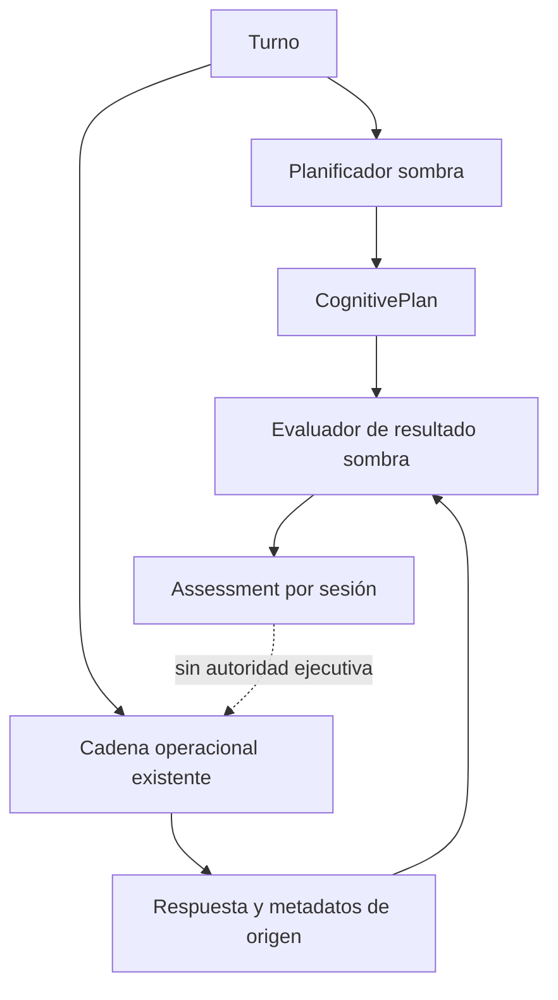

# RP.21.01 — Actualidad y evidencia observadas por el planificador sombra

## Objetivo

Conectar el Planificador Cognitivo en modo sombra con el resultado real de cada
turno para comparar, sin gobernar la ejecución, los requisitos previos de
actualidad y evidencia con los metadatos finalmente producidos.

## Decisiones de diseño

1. El plan previo continúa siendo inmutable y puramente consultivo.
2. La evaluación posterior vive en `core/cognitive_planning/assessment.py` y no
   depende del Router de Actualidad concreto.
3. La comparación consume el contrato estable `ResponseOriginMetadata`, que ya
   expresa origen, frescura, verificación, evidencia, contradicciones y abstención.
4. El adaptador sombra conserva por sesión tanto el plan como su evaluación.
5. Una abstención verificable se considera coherente cuando el plan exigía
   actualidad o evidencia que no pudo obtenerse.
6. Los fallos del evaluador se contienen y nunca modifican ni bloquean respuestas.
7. Ninguna divergencia detectada tiene autoridad ejecutiva en RP.21.01.

## Componentes modificados

- `core/cognitive_planning/models.py`
- `core/cognitive_planning/assessment.py`
- `core/cognitive_planning/__init__.py`
- `app/cognitive_planner_shadow_runtime.py`
- `app/runtime_capability_registry.py`
- `tests/test_rp_21_01_cognitive_planner_current_evidence_shadow.py`

## Flujo

```text
Turno del usuario
       |
       v
Planificador sombra
       |
       `--> CognitivePlan por sesión
                    |
Cadena operacional | existente
       |            |
       v            |
Respuesta + ResponseOriginMetadata
       |            |
       `------------v
          Evaluador sombra
             |- frescura observada
             |- evidencia observada
             |- fuentes contradictorias
             |- verificación
             |- abstención
             `- satisfied / partial / unsatisfied / not_applicable
                    |
                    `--> evaluación por sesión

La evaluación no vuelve a la cadena operacional.
```



## Criterios observados

- **Actualidad:** una respuesta no abstenida satisface el plan cuando declara
  frescura `live`, `recent` o `recent_but_conflicting`.
- **Fuente única:** exige al menos una evidencia y verificación disponible.
- **Corroboración:** exige al menos dos evidencias y verificación completa o parcial.
- **Contradicciones:** quedan registradas sin convertir una versión en hecho.
- **Abstención:** satisface la política cuando la evidencia o frescura requerida no
  está disponible y el sistema se abstiene.

## Impacto sobre revisiones anteriores

- El Router de Actualidad conserva toda autoridad sobre recuperación, edad máxima,
  contradicciones y explicación de abstención.
- El registro interno de confianza de RP.20.54 se reutiliza como fuente de evidencia
  observada, sin duplicar sus reglas.
- RP.21.00 conserva su contrato y comportamiento; solo se agrega evaluación posterior.
- No cambia el texto, origen, orden, selección de herramientas ni decisión final.

## Pruebas agregadas

- evidencia reciente y corroborada satisface un plan de actualidad;
- una respuesta de conocimiento general revela falta de frescura y evidencia;
- una abstención segura se considera coherente;
- las fuentes contradictorias quedan registradas sin modificar la respuesta;
- el registro oficial almacena la evaluación posterior por sesión;
- un fallo del evaluador sombra no altera la respuesta existente.

## Próxima revisión sugerida

RP.21.02 puede exponer métricas agregadas de divergencia entre planes y resultados,
todavía sin gobernar selección ni ejecución, para calibrar umbrales antes de activar
el planificador.

## Certificación

- Ruff: sin errores.
- pytest: 6684 pruebas aprobadas.
- Doctor: resultado listo.
- Compatibilidad: evaluación consultiva, sin autoridad sobre respuestas ni ejecución.
