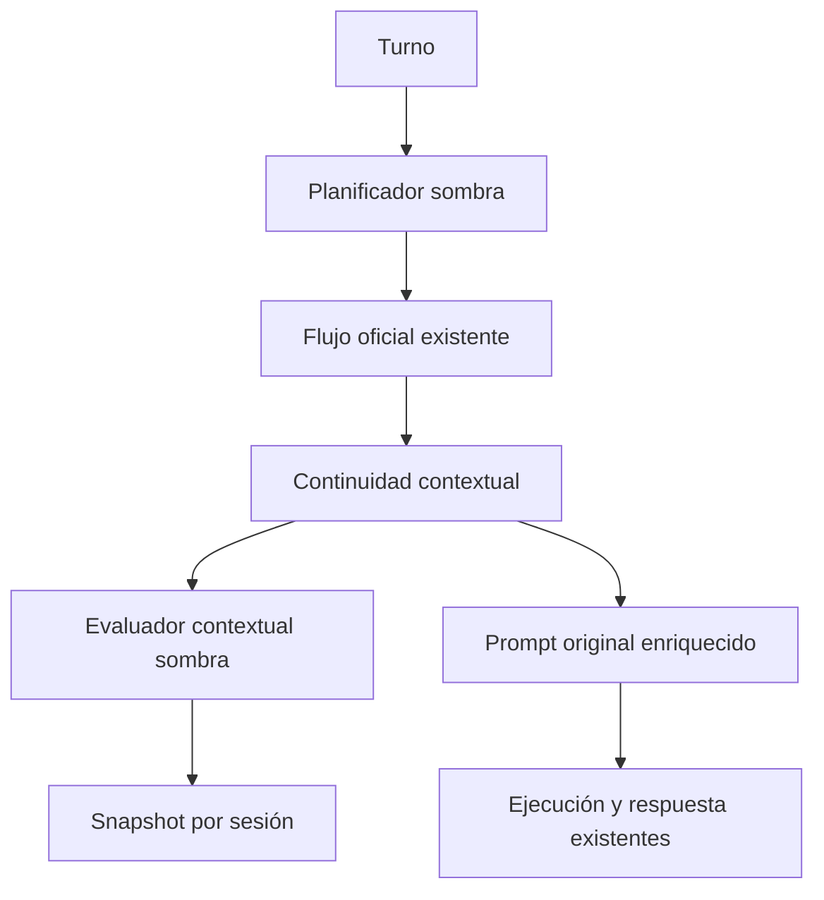

# RP.21.03 — Planificación contextual en modo sombra

## Objetivo

Conectar el Planificador Cognitivo con la continuidad contextual oficial para comparar, sin intervenir, el contexto requerido por el plan con el historial realmente seleccionado e inyectado al prompt.

## Decisiones de diseño

- El planificador sigue siendo consultivo y fail-open.
- La selección real continúa bajo `OfficialContextContinuityRuntimeGateway` y las políticas históricas de sanitización y curación.
- La evaluación ocurre después de la selección contextual, usando cantidades observables y sin leer ni persistir contenido adicional.
- No se recorta, amplía ni reemplaza el prompt según el plan sombra.
- La memoria personal se registra como requisito separado porque su resolución no pertenece al gateway de historial conversacional.
- Los seguimientos con signos de apertura, por ejemplo `¿Y por qué?`, se reconocen como dependientes del contexto anterior.

## Componentes modificados

- `core/cognitive_planning/context_selection.py`: contrato y evaluador contextual puro.
- `core/cognitive_planning/planner.py`: reconocimiento robusto de seguimientos con puntuación inicial.
- `core/cognitive_planning/__init__.py`: exportación de los nuevos contratos.
- `app/cognitive_planner_shadow_runtime.py`: métricas y evaluaciones contextuales por sesión.
- `app/context_continuity_runtime.py`: publicación observacional de la selección real.
- `app/runtime_root_factory.py`: conexión del mismo runtime sombra al gateway contextual.
- `tests/test_rp_21_03_context_planning_shadow.py`: pruebas de integración y compatibilidad.

## Flujo

```text
Turno de usuario
      |
      v
Planificador Cognitivo sombra
      |  declara contexto requerido
      v
Registro oficial / flujo existente
      |
      v
Sanitización y curación contextual
      |  selecciona historial real
      v
Context Selection Assessor
      |  compara plan vs. observación
      v
Snapshot por sesión (solo diagnóstico)
      |
      v
Prompt y respuesta originales, sin cambios
```



## Impacto sobre revisiones anteriores

- Conserva RP.21.00: el plan no gobierna la ejecución.
- Conserva RP.21.01: actualidad y evidencia se evalúan independientemente.
- Conserva RP.21.02: la selección de capacidades sigue gobernada por el registro oficial.
- No cambia los contratos públicos de conversación ni la política histórica de continuidad.
- Los fallos del evaluador contextual no bloquean ni alteran la inyección de contexto.

## Pruebas agregadas

- Seguimiento contextual con historial disponible y seleccionado.
- Requisito de conversación sin historial disponible.
- Detección de contexto inyectado aunque el plan no lo requiera, sin recortar el prompt.
- Contención fail-open ante fallo del evaluador.
- Reconocimiento de seguimientos que comienzan con signo de apertura.

## Certificación

- Ruff: sin errores.
- pytest: 6691 pruebas aprobadas.
- Doctor: resultado listo.
