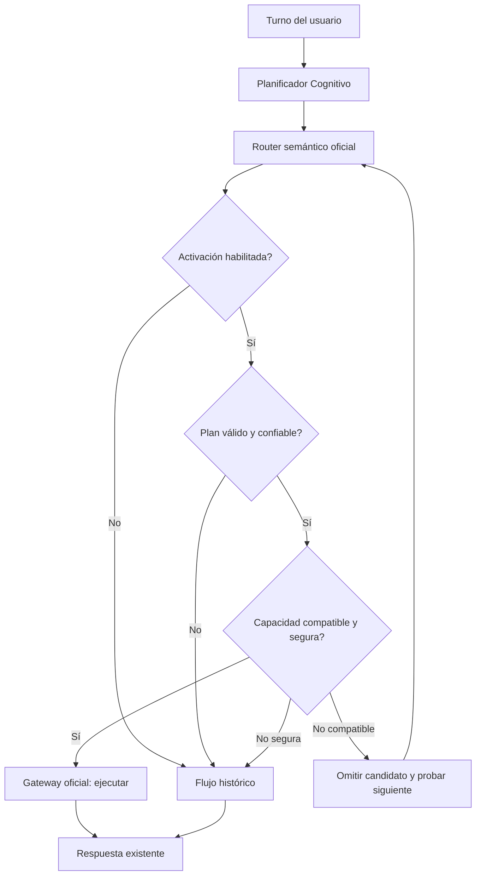

# RP.21.04 — Activación ejecutiva controlada

## Objetivo

Permitir que el Planificador Cognitivo influya por primera vez en la ejecución, pero únicamente en un límite acotado, reversible y gobernado: la evaluación de candidatos del router semántico oficial.

## Decisiones de diseño

- La activación se habilita explícitamente desde la composición oficial del runtime.
- El plan solo puede omitir un candidato semántico cuando es válido, contiene exactamente una herramienta concreta, posee una señal de intención confiable y la capacidad candidata es incompatible.
- Una capacidad compatible se ejecuta por el gateway oficial existente; el planificador no ejecuta proveedores directamente.
- Capacidades deshabilitadas, de riesgo alto o que requieren confirmación fuerzan fallback.
- La ausencia de plan, un plan ambiguo, una política inválida o cualquier excepción conservan el recorrido histórico.
- No se activan todavía abstenciones, recorte de contexto, selección de proveedor ni reescritura de respuestas.

## Componentes modificados

- `core/cognitive_planning/executive_activation.py`
- `core/cognitive_planning/__init__.py`
- `app/cognitive_planner_shadow_runtime.py`
- `app/runtime_capability_registry.py`
- `app/runtime_root_factory.py`
- `tests/test_rp_21_04_controlled_executive_activation.py`

## Flujo



```text
Usuario
  -> Plan cognitivo
  -> candidatos semánticos
       -> sin activación / duda / error: fallback histórico
       -> candidato incompatible: omitir
       -> candidato compatible: gateway oficial
  -> respuesta existente
```

## Impacto sobre revisiones anteriores

- Conserva los contratos y observabilidad de RP.21.00–RP.21.03.
- La activación está deshabilitada por defecto al instanciar el runtime sombra manualmente, preservando integraciones anteriores.
- La fábrica oficial la habilita para el runtime compuesto.
- Las evaluaciones de actualidad, evidencia, herramientas y contexto siguen funcionando.
- No cambia la política de abstención ni el contenido final de las respuestas.

## Pruebas agregadas

- omisión de un candidato semántico incompatible y ejecución del compatible;
- compatibilidad histórica con activación deshabilitada;
- fallback para planes sin confianza suficiente;
- fail-open cuando falla la política de activación.

## Validación

- Ruff: sin errores.
- pytest: 6695 pruebas aprobadas.
- Doctor: resultado listo.
