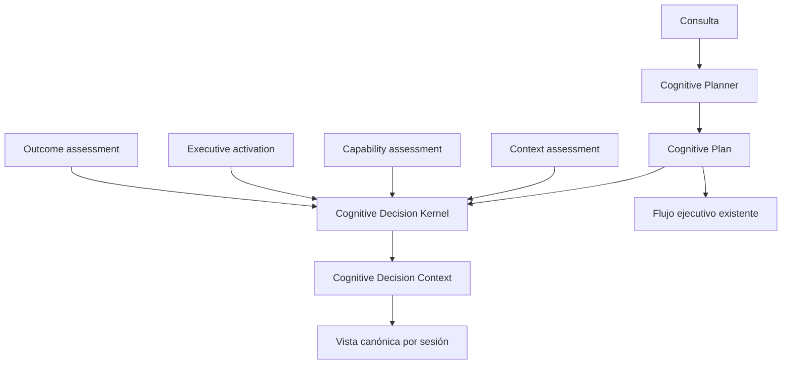

# RP.22.00 — Cognitive Decision Kernel

## Objetivo

Consolidar en un contrato canónico e inmutable las decisiones producidas por la
serie RP.21: intención, contexto, herramientas, actualidad, evidencia, riesgo,
confianza y política de respuesta.

El kernel no reemplaza al planificador, al director ejecutivo ni al router. Su
función en esta revisión es ofrecer una vista única, desacoplada y consultable
por sesión.

## Decisiones de diseño

- Se introduce `CognitiveDecisionContext` como contrato proveedor-agnóstico.
- `CognitiveDecisionKernel` es puro: no ejecuta herramientas, no modifica el
  prompt, no enruta capacidades y no redacta respuestas.
- Los contratos de RP.21 permanecen vigentes y se incluyen dentro del contexto
  canónico para mantener trazabilidad y compatibilidad hacia atrás.
- La consolidación ocurre cada vez que aparece nueva información del plan,
  contexto, capacidad, activación u outcome.
- Los fallos del kernel son fail-open: el plan y el flujo histórico continúan.
- RP.22.00 no introduce resolución de conflictos entre políticas; esa función
  queda reservada para una revisión posterior.

## Componentes modificados

- `core/cognitive_planning/decision_kernel.py`
- `core/cognitive_planning/__init__.py`
- `app/cognitive_planner_shadow_runtime.py`
- `tests/test_rp_22_00_cognitive_decision_kernel.py`

## Flujo

```text
Consulta
   |
   v
CognitivePlanner -> CognitivePlan
   |                     |
   |                     v
   +--> observaciones RP.21 (contexto, capacidad, outcome, activación)
                              |
                              v
                    CognitiveDecisionKernel
                              |
                              v
                    CognitiveDecisionContext
                    - intención
                    - contexto
                    - herramientas
                    - actualidad
                    - evidencia
                    - riesgo
                    - confianza
                    - política
                              |
                              v
                    almacén por sesión

El flujo ejecutivo existente continúa sin cambios.
```



## Contrato canónico

`CognitiveDecisionContext` contiene:

- `intent`;
- `required_context`;
- `required_tools`;
- `freshness`;
- `minimum_evidence`;
- `risk`;
- `confidence`;
- `policy`;
- referencias a plan y evaluaciones observadas;
- códigos de razón deduplicados.

Los niveles iniciales son deliberadamente pequeños y estables:

- riesgo: `low`, `moderate`, `high`;
- confianza: `low`, `medium`, `high`;
- política: `respond`, `respond_with_caution`, `abstain_if_unverified`,
  `fallback`.

## Impacto sobre revisiones anteriores

- RP.21.00–RP.21.04 permanecen compatibles y operativos.
- No cambia la selección de herramientas.
- No cambia el contexto inyectado.
- No cambia la política de actualidad ni evidencia existente.
- No cambia la respuesta visible.
- La activación ejecutiva controlada conserva sus límites y fallback.

## Pruebas agregadas

- consolidación de una consulta de actualidad;
- clasificación de conversación simple de bajo riesgo;
- publicación del contexto canónico por sesión;
- fail-open cuando el kernel falla.

## Certificación

- Ruff: sin errores.
- pytest: 6699 pruebas aprobadas.
- Doctor: resultado listo.
