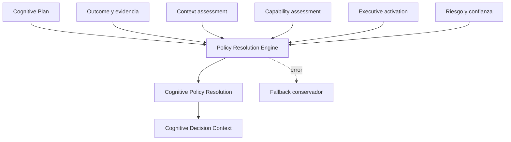

# RP.22.01 — Motor de resolución de políticas

## Objetivo

Resolver de forma determinista los conflictos entre actualidad, evidencia,
contexto, herramientas, riesgo, confianza y activación ejecutiva, produciendo
una única política canónica dentro del `CognitiveDecisionContext`.

La revisión no modifica el texto de las respuestas ni ejecuta decisiones por
sí misma. El motor consolida y explica la política; el flujo operativo anterior
continúa siendo la vía de ejecución y fallback.

## Decisiones de diseño

- Se introduce `CognitivePolicyResolutionEngine` como componente puro y
  proveedor-agnóstico.
- El resultado se representa mediante `CognitivePolicyResolution`, un contrato
  inmutable que contiene política, regla decisiva, conflictos, razones y la
  necesidad de fallback.
- La precedencia es explícita y conservadora:
  1. evidencia obligatoria no satisfecha;
  2. confianza baja;
  3. contexto requerido no satisfecho;
  4. capacidad seleccionada incompatible;
  5. fuentes contradictorias;
  6. fallback solicitado por activación;
  7. riesgo elevado;
  8. respuesta normal.
- La abstención requerida por falta de evidencia domina sobre políticas de
  cautela o fallback porque conserva la regla histórica de nunca inventar
  actualidad.
- Los fallos internos del motor se convierten en una resolución `fallback`
  explicable; no se propaga la excepción al runtime.
- El kernel conserva los contratos de RP.21 y RP.22.00 y añade la resolución
  como un campo nuevo, sin eliminar atributos anteriores.

## Componentes modificados

- `core/cognitive_planning/policy_resolution.py`
- `core/cognitive_planning/decision_kernel.py`
- `core/cognitive_planning/__init__.py`
- `tests/test_rp_22_01_policy_resolution_engine.py`
- `docs/architecture/RP22.01.md`

## Flujo

```text
CognitivePlan
     |
     +-- outcome / evidencia / frescura
     +-- contexto observado
     +-- capacidad seleccionada
     +-- activación ejecutiva
     +-- riesgo y confianza del kernel
     |
     v
CognitivePolicyResolutionEngine
     |
     +-- detecta conflictos
     +-- aplica precedencia
     +-- selecciona regla decisiva
     +-- produce razones trazables
     |
     v
CognitivePolicyResolution
     |
     v
CognitiveDecisionContext.policy

Ante una excepción interna: policy=fallback y el flujo histórico continúa.
```



## Contrato de resolución

`CognitivePolicyResolution` contiene:

- `policy`;
- `decisive_rule`;
- `conflict_codes`;
- `rationale_codes`;
- `fallback_required`.

Las políticas canónicas siguen siendo:

- `respond`;
- `respond_with_caution`;
- `abstain_if_unverified`;
- `fallback`.

## Impacto sobre revisiones anteriores

- RP.21.00–RP.21.04 permanecen compatibles.
- RP.22.00 conserva todos sus campos y comportamiento observable.
- No cambia la selección de herramientas ni proveedores.
- No cambia el contexto inyectado.
- No cambia el texto de respuesta.
- No se activa una nueva abstención fuera de las reglas ya planeadas.
- La activación ejecutiva controlada conserva su fallback histórico.

## Pruebas agregadas

- precedencia de evidencia insuficiente frente a contradicciones;
- fallback por contexto requerido ausente;
- registro y resolución conservadora de capacidad incompatible;
- fail-open ante fallo del motor de resolución;
- respuesta normal cuando las políticas están satisfechas.

## Certificación

- Ruff: sin errores.
- pytest: 6704 pruebas aprobadas.
- Doctor: resultado listo.
