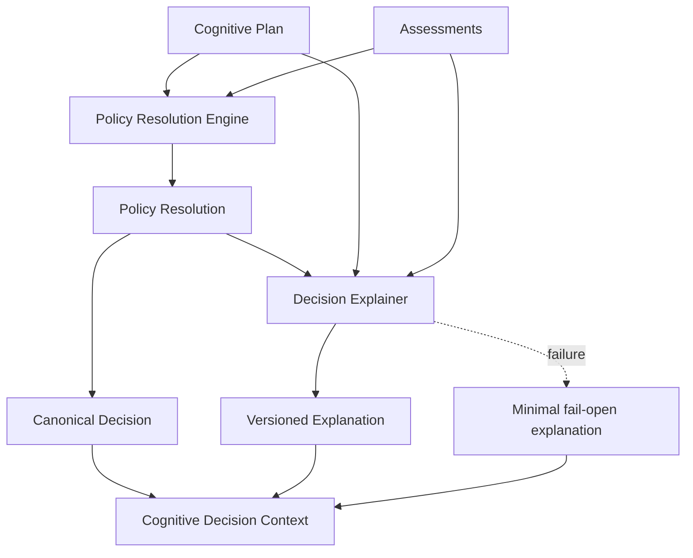

# RP.22.02 — Explicabilidad del kernel

## Objetivo

Publicar una explicación estructurada, estable y serializable para cada decisión
producida por el `CognitiveDecisionKernel`, sin alterar la resolución de
políticas ni el flujo de ejecución.

La explicación debe permitir inspeccionar qué decisión se tomó, qué regla fue
decisiva, qué reglas se evaluaron, qué conflictos participaron y qué señales
sirvieron como evidencia.

## Decisiones de diseño

- Se introduce `CognitiveDecisionExplainer` como componente puro,
  proveedor-agnóstico y sin autoridad ejecutiva.
- La salida se representa mediante `CognitiveDecisionExplanation`, un contrato
  inmutable y versionado con esquema `rp22.02`.
- La explicación conserva la política y la regla decisiva de
  `CognitivePolicyResolution`; nunca recalcula ni sustituye la resolución.
- Las reglas evaluadas se expresan mediante códigos deterministas.
- Las razones del plan y de cada evaluación observada se consolidan como
  `evidence_codes`, eliminando duplicados sin cambiar su orden.
- `as_dict()` ofrece una representación lista para JSON, logs y futuras
  métricas sin exponer objetos internos.
- La narrativa es determinista y diagnóstica; no se usa para reescribir la
  respuesta al usuario.
- Ante un fallo del explicador se conserva la decisión canónica y se publica
  una explicación mínima con `explanation_engine_failure`.

## Componentes modificados

- `core/cognitive_planning/explainability.py`
- `core/cognitive_planning/decision_kernel.py`
- `core/cognitive_planning/__init__.py`
- `tests/test_rp_22_02_kernel_explainability.py`
- `docs/architecture/RP22.02.md`
- `CHANGELOG.md`

## Flujo

```text
CognitivePlan + assessments
            |
            v
CognitivePolicyResolutionEngine
            |
            v
CognitivePolicyResolution
            |
            +-----------------------+
            |                       |
            v                       v
CognitiveDecisionPolicy     CognitiveDecisionExplainer
                                    |
                                    v
                         CognitiveDecisionExplanation
                                    |
                                    v
                         CognitiveDecisionContext

Si el explicador falla, la política ya resuelta se conserva sin cambios.
```



## Contrato de explicación

`CognitiveDecisionExplanation` contiene:

- `schema_version`;
- `decision`;
- `decisive_rule`;
- `evaluated_rules`;
- `conflict_codes`;
- `evidence_codes`;
- `narrative`;
- `fallback_required`.

También expone `as_dict()` para transporte determinista.

## Impacto sobre revisiones anteriores

- RP.21.00–RP.21.04 permanecen compatibles.
- RP.22.00 conserva el contrato canónico del kernel.
- RP.22.01 conserva exactamente su precedencia y resolución de políticas.
- No cambia el texto de respuesta.
- No cambia la selección de herramientas ni proveedores.
- No cambia el contexto inyectado.
- No activa nuevas abstenciones ni fallbacks.
- La explicación se limita a observabilidad y diagnóstico.

## Pruebas agregadas

- publicación de explicación estructurada desde el kernel;
- preservación de conflictos y regla decisiva;
- representación de transporte determinista y lista para JSON;
- comprobación de que el explicador no modifica la resolución;
- fail-open del explicador conservando la decisión canónica.

## Certificación

- Ruff: sin errores.
- pytest: 6709 pruebas aprobadas.
- Doctor: resultado listo.
