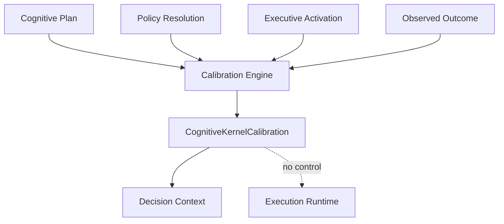

# RP.22.03 — Calibración del Cognitive Decision Kernel

## Objetivo

Medir de forma estructurada la alineación entre el plan cognitivo, la política
resuelta, la activación ejecutiva observada y el resultado real, sin aprender,
reentrenar ni modificar el comportamiento del sistema.

## Decisiones de diseño

- La calibración es inmutable, determinista y versionada (`rp22.03`).
- El motor es puramente observacional: no reescribe planes, políticas o respuestas.
- Las señales ausentes producen estado `incomplete`, no una divergencia artificial.
- Las divergencias se expresan mediante códigos estables y transportables.
- El puntaje es descriptivo y no se usa para activar herramientas o rutas.
- Cualquier error del calibrador falla de forma abierta y preserva la decisión.

## Componentes modificados

- `core/cognitive_planning/calibration.py`
- `core/cognitive_planning/decision_kernel.py`
- `core/cognitive_planning/__init__.py`
- `tests/test_rp_22_03_kernel_calibration.py`
- `docs/architecture/RP22.03.md`
- `CHANGELOG.md`

## Flujo

```text
CognitivePlan
     │
     ▼
PolicyResolution ──────────────┐
     │                         │
     ▼                         │
Executive activation (optional)│
     │                         │
     ▼                         │
Observed outcome (optional)    │
     │                         │
     └──────────────┬──────────┘
                    ▼
       Kernel Calibration Engine
                    │
                    ▼
      CognitiveKernelCalibration
      ├── status
      ├── alignment flags
      ├── divergence codes
      ├── observation codes
      └── score
```



## Impacto

El kernel puede comparar lo previsto con lo resuelto y observado usando un contrato
canónico. Esto habilita métricas posteriores de divergencia, precisión de activación
y frecuencia de fallback sin introducir aprendizaje automático ni autoridad nueva.

## Pruebas añadidas

- publicación de calibración versionada;
- alineación con resultado observado;
- detección de divergencia de resultado;
- serialización determinista y apta para JSON;
- garantía de que el motor es puramente observacional.
