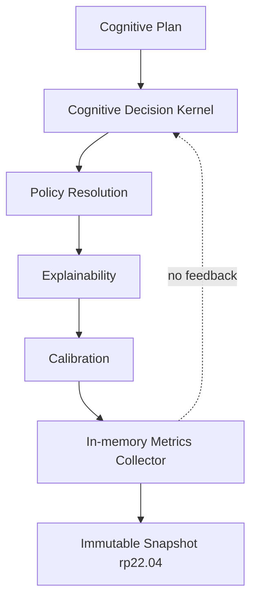

# RP.22.04 — Métricas internas del Cognitive Decision Kernel

## Objetivo

Agregar observabilidad acumulada, local y determinista sobre las decisiones del
Cognitive Decision Kernel, sin convertir las métricas en una fuente de decisión ni
introducir aprendizaje automático, persistencia oculta o telemetría externa.

## Decisiones de diseño

- El colector vive en memoria dentro de cada instancia del kernel.
- La consulta se realiza mediante snapshots inmutables y versionados.
- La recopilación falla de forma abierta: un error de métricas nunca cambia la
  política, calibración, explicación ni respuesta.
- El reinicio es explícito mediante `reset_metrics()`.
- No se escriben archivos ni se transmiten datos.
- Los mapas se exponen como tuplas ordenadas en el contrato inmutable y como
  diccionarios en `as_dict()`.

## Componentes modificados

- `core/cognitive_planning/metrics.py`
- `core/cognitive_planning/decision_kernel.py`
- `core/cognitive_planning/__init__.py`
- `app/cognitive_planner_shadow_runtime.py`
- `tests/test_rp_22_04_kernel_metrics.py`

## Flujo

```text
CognitivePlan
      |
      v
Decision Kernel
      |
      +--> Policy Resolution
      +--> Explainability
      +--> Calibration
      |
      v
Metrics Collector (in-memory, observational)
      |
      v
Immutable Metrics Snapshot
```



## Métricas publicadas

- decisiones totales;
- decisiones con fallback;
- conteo por política;
- conteo por estado de calibración;
- promedio del puntaje de calibración;
- frecuencia por código de divergencia.

## Impacto

No cambia rutas, proveedores, contexto, políticas ni respuestas. El runtime shadow
publica el snapshot del kernel y conserva compatibilidad con kernels inyectados que
no implementen la nueva interfaz, devolviendo un snapshot vacío.

## Pruebas añadidas

1. snapshot inicial vacío y versionado;
2. conteo de políticas y estados de calibración;
3. conteo de fallback y divergencias;
4. serialización determinista;
5. reset explícito y aislamiento de fallos del colector.
