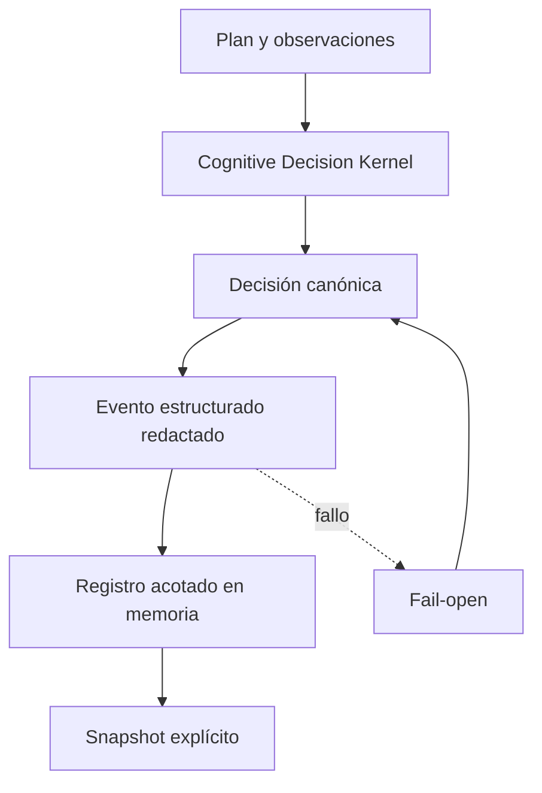

# RP.22.07 — Registro estructurado de decisiones

## Objetivo

Añadir un registro local, versionado y acotado de las decisiones canónicas del
Cognitive Decision Kernel para auditoría y depuración, sin persistencia
automática, telemetría externa ni influencia sobre el comportamiento.

## Decisiones de diseño

- `CognitiveDecisionLogEvent` es inmutable y contiene solo señales estructuradas.
- No se registra texto del usuario, respuestas, narrativas, credenciales ni payloads.
- `CognitiveDecisionLog` vive en memoria y usa una capacidad fija configurable.
- Cuando la capacidad se agota se descarta el evento más antiguo y se incrementa
  `dropped_events`.
- La secuencia es monotónica mientras el registro no se vacía explícitamente.
- `clear_decision_log()` es la única operación de reinicio.
- Cualquier error de registro es fail-open y no modifica la decisión del kernel.
- Doctor valida el esquema, la serialización y la ausencia de narrativa libre.

## Componentes modificados

- `core/cognitive_planning/decision_log.py`
- `core/cognitive_planning/decision_kernel.py`
- `core/cognitive_planning/diagnostics.py`
- `core/cognitive_planning/__init__.py`
- `tests/test_rp_22_07_structured_decision_log.py`
- `tests/test_rp_22_06_doctor_kernel_diagnostic.py`

## Flujo

```text
Plan + observaciones
        |
        v
Cognitive Decision Kernel
        |
        +--> política / explicación / calibración / métricas
        |
        v
CognitiveDecisionLog.record()
        |
        v
buffer acotado en memoria
        |
        v
snapshot inmutable bajo demanda
```



## Impacto

La revisión mejora auditoría y diagnóstico sin crear archivos, transporte,
telemetría o retroalimentación hacia políticas. La compatibilidad se conserva:
si el registro falla, la decisión y el runtime continúan sin cambios.

## Pruebas añadidas

- evento estructurado sin texto sensible ni narrativa;
- capacidad acotada y conteo de descartes;
- snapshot inmutable y serializable;
- vaciado explícito;
- aislamiento fail-open ante fallos del registro.
